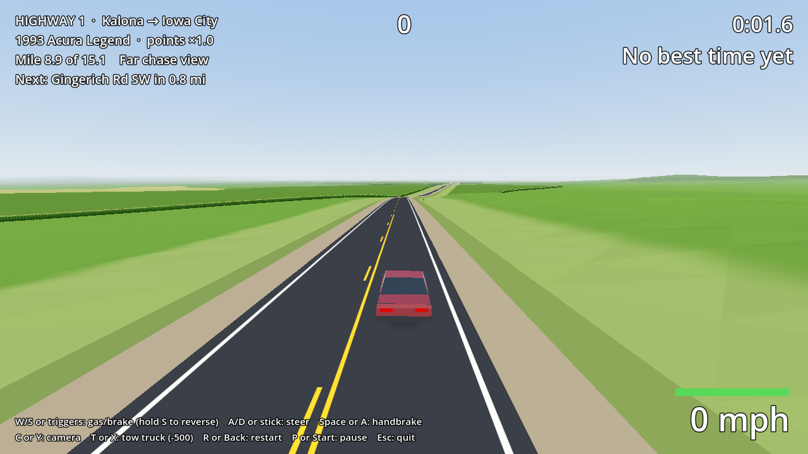

# Highway 1

A tiny, private, chaotic arcade driving game set on 15 real miles of **Iowa Highway 1,
from the IA-22 four-way stop in Kalona to the US-218 interchange at Iowa City.**
Made for fun with friends; not for sale. The full plan is in [PLAN.md](PLAN.md).

**Play it:** grab `HighwayOne-windows.zip` from the
[latest release](https://github.com/DBYoder/Driving-Game/releases/latest), unzip, run
`HighwayOne.exe`. (Windows will warn about an unknown publisher: *More info → Run anyway*.)

| | |
|---|---|
|  |  |
|  |  |
|  |  |

## Status

**v0.3: the three cars.** A 1998 Windstar, a Tercel and an Acura Legend, each with its
own handling, toughness and points multiplier, plus dents and signature parts that fly
off. You pick one (and a paint color) in the garage. They drive the actual Highway 1:
real curves, hills, crossroads, street names and passing zones from USGS data, with a
long view (haze out to 3 km) and deep corn fields.

It's a score attack from Kalona to the US-218 overpass: smash mailboxes, fences and hay
bales, plow corn, get air, near-miss oncoming traffic, get around Amish buggies and
tractors, and don't wreck. Low-poly, built to run on a potato. Cops and deer are next;
see the roadmap in PLAN.md.

## Layout

```
game/                  Godot 4.6.3 project (GL Compatibility renderer)
  data/route/          baked road, terrain and horizon (generated, committed)
  scripts/route/       RouteData, TerrainTiles, HorizonTerrain: loading and querying the baked data
  scripts/world/       road and terrain meshes and colliders, streaming, roadside signs
  scripts/car/         raycast car physics, the three cars (CarStats), models and damage,
                       drivers, engine sound
  scripts/game/        run rules, scoring and combos, timing and records, QA test drives
  scripts/props/       mailboxes, fences, hay bales, corn clumps and the corn canopy
  scripts/traffic/     other road users and crashing into them
  scripts/ui/          the HUD, results and the garage (car select)
  shaders/             flat-shaded terrain and road paint
  tests/               headless GDScript tests
tools/                 Python pipeline that bakes the road from USGS data
docs/                  route previews, screenshots, the README that ships in the zip
.github/workflows/     CI: tests, Windows/Linux export, screenshots, releases
```

## Developing

**Game:** install [Godot 4.6.3](https://godotengine.org/download/archive/4.6.3-stable/)
(standard build, not .NET), open `game/project.godot`, press F5.

```sh
godot --headless --path game --import                   # first time, or after adding files
godot --headless --path game -s res://tests/run_tests.gd  # unit tests
godot --path game -- --car=tercel --station=15000 --view=3  # skip the garage, mid-route, drone view
godot --path game -- --autopilot --autopilot-mph=90       # watch the autopilot drive (and pass)
godot --path game -- --station=2400 --traffic-near        # start with traffic in view

# Automated test drives, headless and ~25x faster than real time:
godot --headless --fixed-fps 60 --path game -- --qa-drive            # autopilot, all 15 miles
godot --headless --fixed-fps 60 --path game -- --qa-stress --seed=1  # hooligan inputs
godot --headless --fixed-fps 60 --path game -- --qa-drift            # scripted handbrake turn
godot --path game -- --benchmark                                      # fps, draw calls, triangles
godot --path game -- --car=legend --damage=0.7 --orbit                # look at the damage
godot --path game -- --tune=handbrake_grip:0.5                        # try a CarStats tweak
```

**Road data:** only needed to re-bake (the baked files are committed).

```sh
pip install -r tools/requirements.txt
python tools/bake_route.py     # downloads ~190 MB of USGS road data once, caches it in tools/.cache/
python tools/preview_route.py  # writes docs/route-preview/*.png to eyeball the result
python -m pytest tools/tests
```

Pushes to `main` build a Windows zip and publish it as a GitHub release.

## Data credits

- Road centerlines: USGS National Transportation Dataset (NTD) for Iowa, public domain.
- Elevation: USGS 3D Elevation Program, 1/3 arc-second DEM, public domain.
- Engine: [Godot](https://godotengine.org), MIT license.
