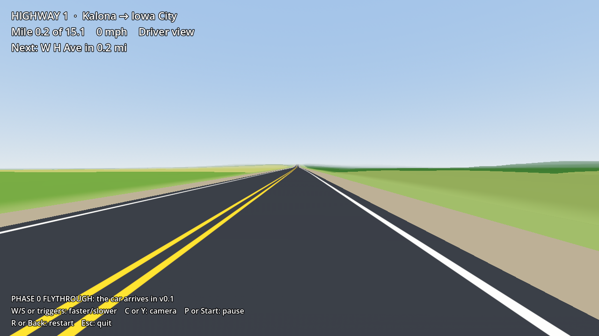

# Highway 1

A tiny, private, chaotic arcade driving game set on 15 real miles of **Iowa Highway 1,
from the IA-22 four-way stop in Kalona to the US-218 interchange at Iowa City.**
Made for fun with friends; not for sale. The full plan is in [PLAN.md](PLAN.md).

**Play it:** grab `HighwayOne-windows.zip` from the
[latest release](https://github.com/DBYoder/Driving-Game/releases/latest), unzip, run
`HighwayOne.exe`. (Windows will warn about an unknown publisher: *More info → Run anyway*.)

| | |
|---|---|
|  |  |

## Status

**Phase 0: the real road.** A flythrough of the actual Highway 1: real curves, hills,
crossroads and street names from USGS data, low-poly, built to run on a potato.
The drivable car arrives in v0.1 (see the roadmap in PLAN.md).

## Layout

```
game/                  Godot 4.6.3 project (GL Compatibility renderer)
  data/route/          baked road + terrain (generated, committed)
  scripts/route/       RouteData, TerrainTiles: loading and querying the baked data
  scripts/world/       road and terrain meshes, streaming, roadside signs
  shaders/             flat-shaded terrain and road paint
  tests/               headless GDScript tests
tools/                 Python pipeline that bakes the road from USGS data
docs/                  route previews, screenshots, the README that ships in the zip
.github/workflows/     CI: tests, Windows/Linux export, screenshots, releases
```

## Developing

**Game:** install [Godot 4.6.3](https://godotengine.org/download/archive/4.6.3-stable/)
(standard build, not .NET), open `game/project.godot`, press F5.

```sh
godot --headless --path game --import                   # first time, or after adding files
godot --headless --path game -s res://tests/run_tests.gd  # unit tests
godot --path game -- --station=15000 --view=2             # start mid-route in drone view
```

**Road data:** only needed to re-bake (the baked files are committed).

```sh
pip install -r tools/requirements.txt
python tools/bake_route.py     # downloads ~190 MB of USGS road data once, caches it in tools/.cache/
python tools/preview_route.py  # writes docs/route-preview/*.png to eyeball the result
python -m pytest tools/tests
```

Pushes to `main` build a Windows zip and publish it as a GitHub release.

## Data credits

- Road centerlines: USGS National Transportation Dataset (NTD) for Iowa, public domain.
- Elevation: USGS 3D Elevation Program, 1/3 arc-second DEM, public domain.
- Engine: [Godot](https://godotengine.org), MIT license.
